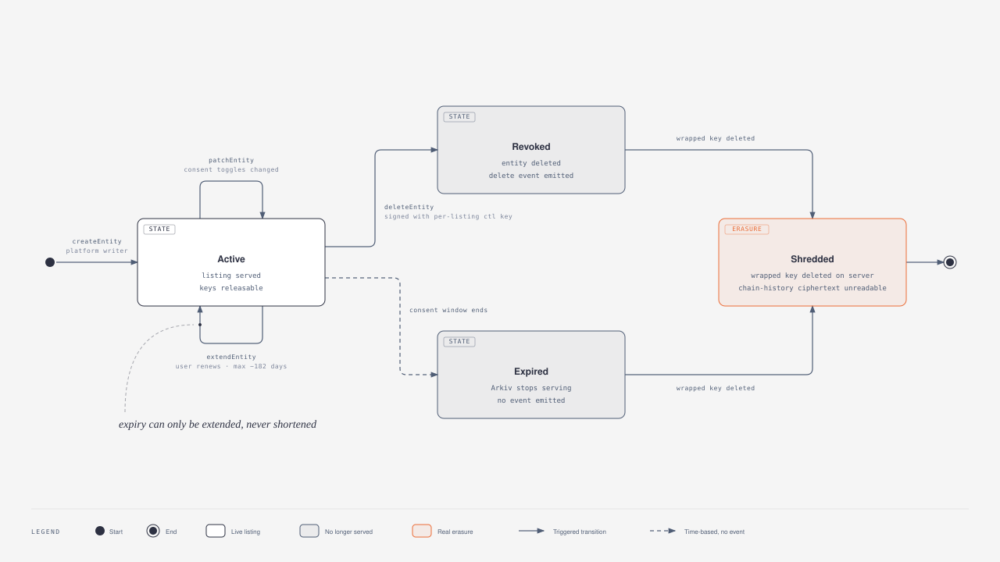
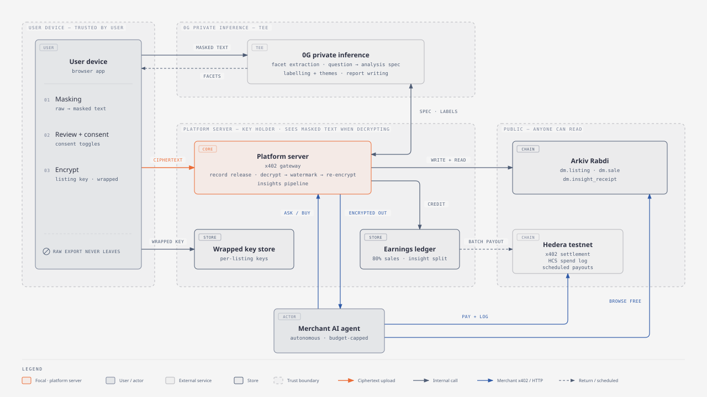
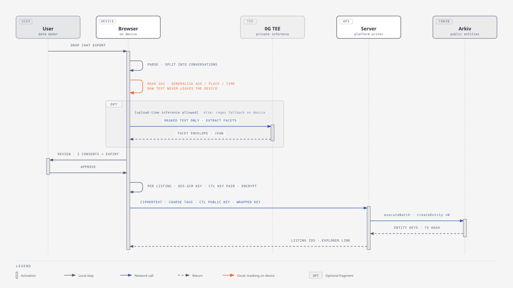
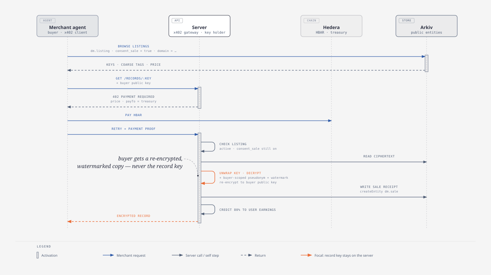
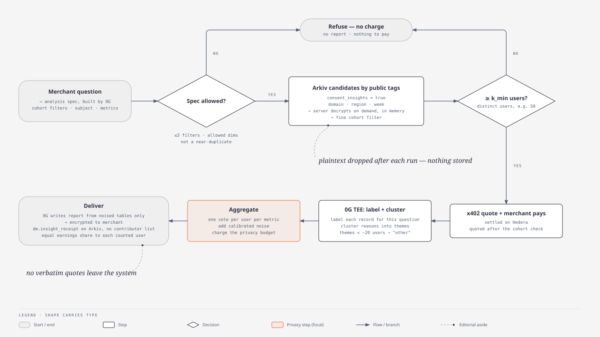

# Architecture and data flow

This is the source of truth for the current architecture; [plan-v2.md](plan-v2.md) is partly outdated. Diagrams live in [diagrams/](diagrams/) as SVG (embedded below) and self-contained HTML. This document explains how data moves through the system, what Arkiv can and cannot do for us, and how the analytics (insights) pipeline works. The analytics part is a rough sketch, not a specification. Items tagged **verify:** are assumptions not yet tested.

## 1. Two products, two privacy treatments

The marketplace sells two things. Each gets a different privacy treatment.

| | Insights (main product) | Record sale |
| --- | --- | --- |
| What the merchant gets | An aggregated report about a cohort, e.g. "why budget-conscious 18–24s abandon serums" | One user's masked record |
| Privacy treatment | **Anonymisation** | **Pseudonymisation** |
| What that means | The output cannot be tied to any individual, even when combined with outside data | Direct identifiers are replaced, but the record is still about one person, and the key holder can link it back |
| Legal status (GDPR, India DPDP) | Truly anonymous output falls outside personal-data rules | Still personal data, so it needs specific consent |
| User consent toggle | "Use my data in aggregate insights" | "Allow sale of my record" |
| How the user is paid | Equal share of each report's fee among the users counted in it | 80% of each record sale |

Both toggles are set per upload and can be changed later. Most users are expected to turn on only the first. That grows the insights supply without forcing anyone into record sales.

### 1.1 Pseudonymisation (record sale)

- **On the device:** names, phone numbers, emails, IDs, addresses and similar identifiers are replaced with typed placeholders (`[PERSON_1]`, `[CITY_1]`). Quasi-identifiers are generalised: exact age becomes an age band, an exact location becomes a region or city tier, and exact timestamps become a week.
- **Buyer-scoped pseudonym:** each delivered record carries `psn = HMAC(server_secret, user_id ‖ buyer_id)`. One buyer can tell that two records they bought came from the same person, which is useful for them. Two different buyers cannot join their purchases on that value.
- **Per-buyer watermark:** placeholders are rewritten with buyer-specific random tokens before delivery. A leaked copy identifies the buyer.
- **Residual risk:** masked text can still be re-identifying when combined with other data. That is why the data stays legally personal and is sold only behind the explicit sale toggle.

### 1.2 Anonymisation (insights)

No record leaves the system. Only aggregates do, and only after these protections:

1. **Minimum cohort of distinct users,** not records, e.g. 50. A smaller cohort returns no report. This is separate from the browsing rule removed from plan v2; it applies only to aggregates, because an "aggregate" over two people is just their data.
2. **Contribution bounding:** each user counts at most once per metric, however many records they uploaded. The server knows which user owns each listing, for payouts, so it can enforce this.
3. **Noise:** calibrated random noise (differential privacy) on every count and share. No single person changes a result in a detectable way. A per-cohort privacy budget limits how many questions can be asked about the same group over time.
4. **Small-cell suppression:** any theme, brand or bucket with fewer than about 20 users is merged into "other".
5. **No differencing:** at most three cohort filters per question, and near-duplicate questions are refused. Otherwise "cohort A" minus "cohort A without Mumbai" reveals one person.
6. **No verbatim quotes:** reports show themes. Any illustrative quote is generated from a theme label and marked as synthetic.
7. **No public contributor list:** see section 4.3.

## 2. What we learned about Arkiv

Read on 2026-11-06 from docs.arkiv.network: introduction, first entity, column types, create, expiration, change, batches, paginate, watch events, query language, limits and the Rabdi network page. The filter, count and get-entity pages were not read, so details there are tagged **verify:**.

| Arkiv fact | Design consequence |
| --- | --- |
| Everything is public; there is no built-in encryption or access control | Encrypt on the client. Public attributes must be safe for anyone to read |
| Attributes are typed (`str` up to 128 bytes, `u64`, `bool`, `key`, `bytes`, ...), up to 32 per entity | Coarse public tags fit easily. `key` attributes can link entities, e.g. a sale receipt to its listing |
| `bytes` values have a 128 KiB budget per create, and `bytes` cannot be filtered | One listing per conversation or chunk, not one per whole export. Ciphertext is stored, never queried |
| Queries support `=`, `<`, `<=`, `>`, `>=`, `BETWEEN`, `STARTSWITH`, `EXISTS`, `AND`/`OR`, and only on indexed attributes; pages hold at most 100 rows | Merchant browsing and candidate selection use public tags. Use keyset paging for full scans |
| `count` is the only server-side aggregation (**verify:** count page) | **Arkiv is not the analytics engine.** It returns candidates; analysis happens off-chain |
| Lifetime counts in 2-second blocks, maximum about 182.5 days. Extend only, never shorten | Consent window capped at 6 months. Renewal uses `extendEntity` |
| Only the owner can patch, extend, transfer or delete. `$owner` and `$creator` are public | Platform writer owns listings, so users' wallets never appear. Users act through signed requests |
| Events exist for create, patch, extend, transfer and delete, but **not for expiry** | Avoid any standing copy that would need eviction on expiry (section 4.1) |
| Expired or deleted entities stop being served. Whether ciphertext stays in transaction history is not documented | Assume it stays forever. Revoke and expiry mean the server refuses to release; they are not erasure |
| Writes cost tGLM on Rabdi (chain 7794095). The public RPC is heavily rate limited | Fund the platform writer from the faucet. Use an access key for the server |

### 2.1 Entity types on Arkiv

| Entity | Public, indexed attributes | `bytes` | Owner | Expiry |
| --- | --- | --- | --- | --- |
| `dm.listing` | `listing_id`, `domain` (top-level, fixed vocabulary), `region`, `source`, `week` (u64), `quality_tier`, `consent_insights` (bool), `consent_sale` (bool), `price` (u64, tinybars); unindexed `envelope_format` | `ciphertext` (the record), `wrapped_key` (record key sealed to the service), `sealed_seller` (seller info sealed to the service); all together ≤ 128 KiB | Platform writer | User's consent window, ≤ 182 days |
| `dm.sale` | `listing` (key), `buyer_ref` (hash), `payment_tx` (str), `price` (u64) | — | Platform writer | Long-lived audit record |
| `dm.insight_receipt` | `spec_hash`, `domain`, `cohort_bucket` (e.g. "50–99"), `epsilon`, `k_min`, `payment_tx`, `contributors_root` (Merkle root) | `sealed_contributors` (contributor list and shares, sealed to the service) | Platform writer | Long-lived audit record |
| `dm.payout` | `batch_id`, `scheduled_tx` (str) | `sealed_lines` (who was paid what, sealed to the service) | Platform writer | Long-lived audit record |

Rules for public attributes:
- **Nothing per user:** no wallet, no user id, no attribute that is the same across one user's listings. Anything that identifies the seller lives only inside `sealed_seller`.
- **Few and coarse:** every public attribute makes listings easier to single out. Keep them to the list above.
- **Insight reports themselves are not on Arkiv:** the paying merchant receives the report encrypted to their key. Only the receipt is public, so anyone can audit the privacy parameters used (cohort size bucket, noise level, threshold) and the payment.

### 2.2 Listing lifecycle



[Full-page HTML version](diagrams/listing-lifecycle.html)

The user proves control of a listing by signing with the per-listing control key kept on the device. Its public half is inside `sealed_seller`, so only the server can check the signature; it then calls Arkiv on the user's behalf.

"Closed" in the diagram means the server refuses every further release for that listing. The wrapped key stays sealed on Arkiv, so this is a refusal enforced by the service, not cryptographic erasure.

### 2.3 No private database: private state is sealed onto Arkiv

The server keeps no database. Everything it must remember but must not publish is encrypted to the service's public key ("sealed") and stored on Arkiv. The server's only secrets are environment variables: the service private key, the Arkiv writer key and the Hedera treasury key.

| Private state | Where it lives |
| --- | --- |
| Record key | `wrapped_key` on the listing |
| Seller's payout account, per-user reference (for one vote per user), listing control public key, consent deadline | `sealed_seller` on the listing |
| Which users were counted in an insight report, and their shares | `sealed_contributors` on the receipt |
| Earnings | Derived on demand: 80% of each `dm.sale` plus shares from receipts, minus `dm.payout` lines |
| Payment replay protection | Each payment tx is recorded on `dm.sale` or `dm.insight_receipt`; the server checks for it before releasing. **verify:** whether the Hedera facilitator already rejects a reused payment |

Why: "Arkiv is our only database" is the strongest answer to the Arkiv track's "why Arkiv" criterion, and the server stays stateless. Cost: sealed blobs still leak their size and timing, and anyone holding the service private key can read all private state.

### 2.4 Encryption format

| Layer | Choice |
| --- | --- |
| Record body | `arkiv-encryption` (`encryptBytes` / `decryptBytes`: AES-256-GCM, random 12-byte IV). Inside the encrypted JSON: `listing_id`, schema version and consent deadline; after decrypting, the server checks they match the listing. `envelope_format` records the format version |
| Sealing to the service or to a buyer | One small Web Crypto helper, `sealTo(publicKey, bytes)`: ephemeral ECDH P-256 + HKDF-SHA-256 + AES-256-GCM. Used for `wrapped_key`, `sealed_seller`, `sealed_contributors`, `sealed_lines`, and buyer delivery |
| Buyer delivery | Fresh record key, `encryptBytes` on the watermarked copy, that key sealed to the buyer's public key |
| Service public key | Pinned in app config, never fetched at runtime |

Binding the listing context inside the authenticated plaintext gives the same protection as AAD here, because only the trusted platform writer publishes listings and the server checks both. The package's lack of AAD and a version header goes into `/arkiv/friction.md`.

## 3. System architecture



[Full-page HTML version](diagrams/system-architecture.html)

### 3.1 Who sees what

| Party | Sees | Never sees |
| --- | --- | --- |
| User device | Raw export, masked text, keys at creation | — |
| 0G TEE provider | Masked text at upload (facet extraction) and at query time (labelling); question text; noised aggregate tables | Raw export, user identity, unnoised per-user labels outside the TEE (**verify:** 0G private route attestation) |
| Platform server | Service private key (so it can unseal anything on Arkiv); masked text and facets **at the moment** of a sale or insight query; which user owns which listing (for payouts) | Raw export |
| Arkiv readers | Coarse public tags, ciphertext sizes, sale and insight receipts | Masked text, facets, user identity, which listings fed which report |
| Merchant (insights) | Noised, thresholded report for one cohort | Any single record or contributor |
| Merchant (record sale) | One masked, watermarked, pseudonymised record | Raw export, user's account, other buyers' pseudonyms |
| Hedera observers | Payments to the treasury; scheduled batch payouts to users | Which report or sale a payout came from |

The server sees masked text whenever it decrypts. This follows from the approved decision that the app server holds keys, and the pitch must say so. Moving the decrypt-and-analyse step into a 0G TEE is the upgrade path.

## 4. Data flows

### 4.1 Upload



[Full-page HTML version](diagrams/upload-sequence.html)

Facet extraction needs an LLM, which is too heavy for most browsers. The default is the 0G private (TEE) route on **masked** text, with a regex and keyword fallback on the device. A user who refuses any upload-time inference still gets masking and coarse tags; their listings simply have fewer facets.

For the hackathon, keep the existing single review after facet extraction and before encryption/publication. A separate masked-text review before sending to 0G is deferred. On the default route (users can opt out), masked text leaves the device before that final review; raw exports stay local.

### 4.2 Record purchase (pseudonymised)



[Full-page HTML version](diagrams/purchase-sequence.html)

### 4.3 Insights (anonymised)



[Full-page HTML version](diagrams/insights-pipeline.html)

**Hackathon scope (confirmed 2026-11-06):** merchants choose from premade, supported analysis options and their allowed cohort filters. Each option maps to a predefined analysis spec; arbitrary merchant instructions are not executed. Include an **Other — coming soon** option describing future English-query support, but do not implement free-text query input, interpretation or execution yet. 0G still performs the selected analysis's query-time labelling, theme naming and report writing.

Why decrypt on demand instead of keeping a decrypted analytics database:
- **Revoke and expiry exclude listings from new analyses.** An expired or deleted listing is no longer returned by Arkiv, and the server only releases or analyses listings that are live. There is no standing plaintext analytics copy to evict.
- **No standing plaintext copy** of masked text to leak.
- **Cost:** a full candidate scan per question. Fine at demo and early scale (keyset paging, 100 rows per page). A cache of decrypted facets, keyed by entity and checked against `$expiresAt` on every read, is a later optimisation.

The price is quoted after the cohort-size check, so a merchant never pays for a refused question. The quote itself does reveal "this cohort has at least k_min users"; that is acceptable and intended.

For the hackathon, eligibility and consent are checked when an analysis starts. Revocation during an in-flight analysis, recomputation and refunds caused by that race are deferred; a running analysis may finish with data already admitted. This does not defer revocation checks for subsequent analyses or record purchases.

### 4.4 Payouts

- **Sales:** 80% of each sale is credited to the owning user's earnings.
- **Insights:** the merchant's fee (minus the platform share) is split equally among the distinct users counted in the report.
- **Schedule:** all earnings are paid in one batch on a fixed schedule (for example daily), mixing sales and insights, using Hedera Scheduled Transactions. Paying contributors right after a report settles would let anyone link their Hedera accounts to that report's cohort.
- **Small amounts:** balances below a minimum carry over to the next batch.
- **Proof of inclusion:** each receipt's `contributors_root` lets a user check, privately, that they were counted in a report, using a Merkle proof the server gives only to them.

## 5. Facet envelope (extracted from the data itself)

Supported exports, the common conversation format and the rule that only the uploader's own messages become data are in [data-sources.md](data-sources.md).

Chats are about anything, so the extracted record is domain-agnostic. Nothing is skincare-specific; skincare is just one value that `domain` and `subject` can take.

```
listing_record
  domain_path:     open path, e.g. beauty/skincare/serum (top level is the fixed public `domain`)
  person_signals:  age_band, life_stage, budget_consciousness (each with source: declared | inferred, and confidence)
  mentions[]:
    subject:       free text, e.g. a brand, product, service or topic
    subject_type:  brand | product | service | place_type | topic
    events:        considering | compared | bought | used | repurchased | abandoned | recommended | complained
    sentiment:     -1.0 to 1.0
    aspects[]:     { aspect: free text, polarity, reason: free text }
    price_signals: { amount_band, currency, judgement: too_expensive | fair | cheap }
    alternatives:  { switched_from, switched_to }
    when:          week
  excerpts[]:      up to 3 short masked excerpts
  provenance_hash: hash of the original export
```

Two extraction passes:
- **Upload time (broad):** the envelope above, from masked text. Cheap and generic, because the questions are not known yet.
- **Query time (targeted):** for a specific question, the 0G TEE re-reads the cohort's masked excerpts and labels exactly what was asked (for example, the abandonment reason). Free-text reasons are clustered into themes with embeddings, so categories such as "too expensive", "no visible results" or "irritation" emerge from the data rather than from a fixed list.

Masking must keep brand and product names, which ordinary name detection would remove as organisations. The masker uses an allowlist of brands and products, so `[ORG]` is applied only to names not on it.

Age is rarely stated reliably in chats. `age_band` comes from an optional declared profile at upload when available; inferred values carry a confidence score, and cohort filters can require declared values.

## 6. How analytics and Arkiv shape each other

- **Arkiv's role is storage, consent and audit, not querying.** It is the source of truth for which listings exist, which consents are on and when they expire. It is also the public audit trail for sales and insight receipts. All fine-grained analysis is off-chain.
- **Public attributes trade privacy for query speed.** Every attribute pushed to public makes candidate selection cheaper but listings easier to single out. Decision: only the coarse tags in section 2.1 are public; everything the analytics needs beyond that is decrypted on demand.
- **Chunking follows the 128 KiB limit.** One listing per conversation (or chunk of a long one). This also gives the insights pipeline natural units, and contribution bounding stops a user with many listings from dominating a cohort.
- **Consent toggles are Arkiv attributes.** Changing a toggle is a `patchEntity`, and both flows re-check the flag at the moment of use.
- **Consent windows are capped by Arkiv's maximum lifetime** (about 182 days); renewal is an extension.
- **Revoke is refusal, not erasure.** Ciphertext and sealed keys may survive in chain history. The server refuses to use any listing that is not live on Arkiv.
- **Receipts make privacy auditable.** Anyone can read every `dm.insight_receipt` and check that no report used a cohort below `k_min` or an excessive noise budget, without learning who was in any cohort.

## 7. Where each sponsor sits

Sponsor tracks are the core of the build; requirements and evidence are in [plan-v2.md §2](plan-v2.md).

| Sponsor | Where it sits in the flows above | Evidence a judge sees |
| --- | --- | --- |
| **0G** (Private Computer) | Upload-time facet extraction (4.1); query-time labelling, theme naming and report writing for premade analyses (4.3) | 0G request IDs on the review screen and in every insights report |
| **Arkiv** (Build on Arkiv) | `dm.listing` index, consent toggles and expiry (2.1, 2.2); merchant browsing and agent discovery (4.2); `dm.sale` and `dm.insight_receipt` audit trail | Explorer links, writer address, a runnable query, and three app screens that read from Arkiv |
| **Hedera** (x402 agents) | x402 settlement for records (4.2) and insight reports (4.3); scheduled batch payouts (4.4); HCS topic logging each merchant-agent payment | HashScan links for settled payments, the HCS audit topic and scheduled payout transactions |

The merchant agent runs without a human approving payments. It discovers endpoints from Arkiv listings, enforces its own budget and per-purchase cap, pays via x402, and writes each payment to its HCS topic.
